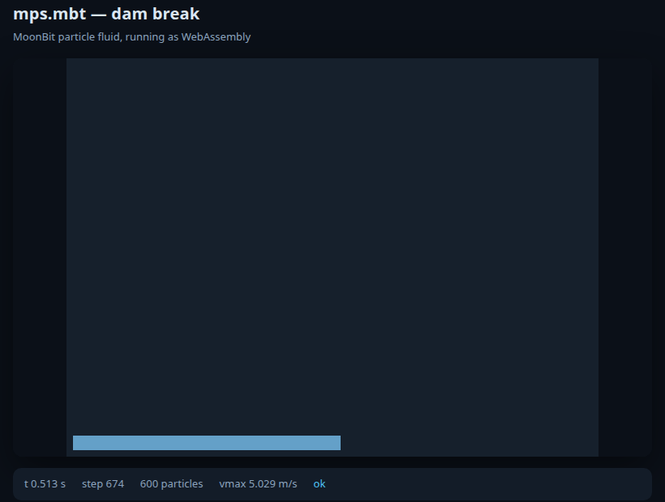

# mps.mbt

Moving Particle Semi-implicit (MPS) particle fluid simulation written in
MoonBit, with a dam-break demo that runs natively and in the browser.

Built only on `moonbitlang/*` packages and the MoonBit standard library: no
external mooncakes, no JavaScript or C FFI beyond the single
`spectest.print_char` import that every `wasm-gc` print goes through.

> **Status.** The demo runs the deterministic `Mode::Kinematic` model (gravity,
> advection, wall clamping). The full MPS pressure step exists in `Params::mps()`
> but the hydrostatic column does not yet build pressure; see
> [docs/physics-status.md](docs/physics-status.md).



## What is here

| package | role |
| --- | --- |
| `core` | `Vec2`, fixed-decimal number formatting, deterministic RNG, uniform-grid search with Verlet lists, byte buffer |
| `mps` | particles, dam-break scene, kernels, number density, viscosity, CFL time step, pressure Poisson solve (experimental), typed step status |
| `render` | `Frame`, tab-separated snapshot lines, water palette, bitmap and terminal renderers |
| `host/native` | CLI and the native runner: headless `FRAME` output or terminal animation |
| `host/browser` | one browser session: prints `FRAME` lines for the page |
| `web` | Canvas viewer, worker-free; the page drives one session at a time |
| `tools` | static server, headless screenshot, native-vs-wasm differential gate |

`docs/element-technologies.md` records which pieces MPS needed and what was
missing (and what still is) on the MoonBit side.

## Run it natively

```sh
moon build --release --target native
./_build/native/release/build/cmd/terminal/terminal.exe --animate --steps 600
./_build/native/release/build/cmd/terminal/terminal.exe --steps 300   # FRAME lines
```

## Run it in the browser

```sh
moon build --release --target wasm-gc
node tools/serve.mjs 8080 .
```

Open <http://127.0.0.1:8080/web/>. The page fetches
`_build/wasm-gc/release/build/bridge/bridge.wasm`, runs one 300-step session per
load, and replays it at 60 frames per second.

## Verify

```sh
moon check --target native --deny-warn
moon check --target wasm-gc --deny-warn
moon check --target js --deny-warn
moon test --target native
moon test --target js
sh tools/smoke.sh            # native and wasm-gc FRAME lines are byte-identical
```

The same commands run in CI (`.github/workflows/ci.yml`).

## Design notes

- **No FFI in the simulation.** The wasm host's only import is
  `spectest.print_char`; every number a host reads goes through the
  tab-separated `FRAME` line produced by `render.snapshot_line`, which formats
  through `core.fmt_fixed` so the text is identical on every backend.
- **Determinism as a test.** The native and `wasm-gc` builds run the same steps
  and `tools/smoke.sh` compares their output byte for byte. Determinism is what
  lets one implementation serve both hosts.
- **One step, one neighbour list.** `Simulation::step` builds the interaction
  neighbourhood once per step; no stage reads stale pairs, so the step is a
  pure function of the state.
- **Frame contract.** `FRAME <step> <time> <w> <h> <p_max> <v_max> <status>
  <count> <x y ...>`; `status` is `start`, `ok`, `stalled` or `diverged`.

## License

MIT.
